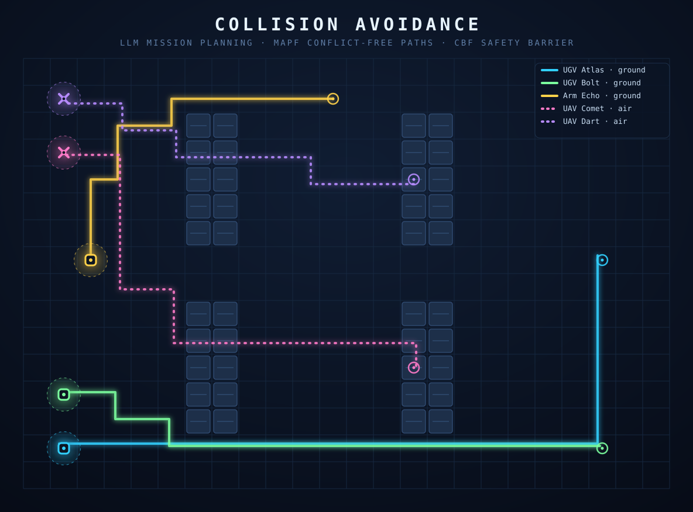
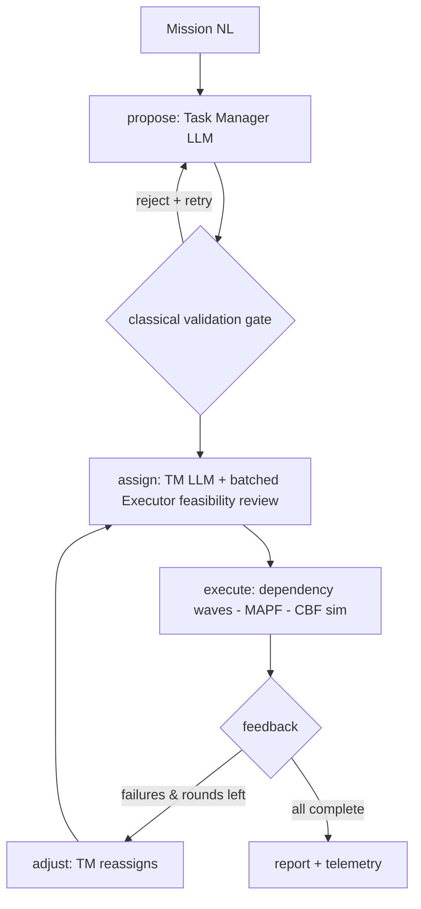

<p align="center">
  
</p>

<p align="center"><em>The banner is not concept art — it is the real output of this repo's MAPF planner over the demo warehouse, rendered by <code>bun scripts/render-hero.ts</code>. Five robots, zero conflicts.</em></p>

# Collision Avoidance — LLM Multi-Robot Orchestration

Give a heterogeneous robot fleet a mission in plain English. An LLM decides **who does what in what order**; deterministic planners and control-barrier math guarantee **nobody ever collides**. Built on [Mastra](https://mastra.ai) workflows.

```
"Survey all four racks for damaged stock, then deliver a pallet to staging,
 then have the arm robot inspect it."
```

→ drones fan out in parallel over the racks, a rover hauls the pallet through a conflict-free corridor, the arm robot follows once delivery lands — and when a robot dies mid-mission, the system notices, replans, and reassigns the work to another capable robot. No per-robot scripting.

## What this repo does

- **Natural-language tasking** of a mixed fleet (2 UGVs, 1 UGV-arm, 2 UAVs) via a capability model: fly, drive, carry, manipulate, sense. The Task Manager LLM matches work to hardware.
- **Provably collision-free execution.** The LLM is architecturally incapable of steering robots into each other — it never emits paths, velocities, or timing.
- **Self-healing missions.** A COHERENT-style PEFA loop (Proposal → Execution → Feedback → Adjustment) reassigns failed subtasks across rounds. Breakdown injection is built in for failure drills.
- **Full auditability.** Every decision, reassignment, near-miss separation, and CBF intervention lands in a per-mission event log and telemetry.

## How it works

Three-tier control stack — the near-universal architecture in the 2024–2025 LLM-multi-robot literature, because LLMs are excellent at symbolic task logic and hopeless at geometry:

| Layer | Owner | Role |
|---|---|---|
| High: mission decomposition, allocation | **LLM** (Task Manager + Robot Executor agents) | who / what / order — Zod-structured output only |
| Mid: conflict-free routing | **MAPF** — space-time A* + reservation tables, CBS-lite priority reordering | collision-free paths per layer (UAVs overfly racks) |
| Low: motion under a safety guarantee | **CBF filter** — barrier `h = ‖Δp‖ − Dₛ`, enforcing `ḣ ≥ −αh` | clips any unsafe velocity, whatever upstream commanded |



The whole loop is one Mastra workflow (`src/mastra/workflows/pefa.ts`): `propose → dountil(assign → execute → feedback/adjust) → report`. Every LLM output passes a **classical validation gate** (dependency cycles, out-of-bounds targets, rack collisions, capability satisfiability) with one corrective retry, then a deterministic greedy fallback — a hallucinated plan physically cannot reach a robot.

## Why it's efficient

- **LLM cost scales with mission complexity, not fleet size or control rate.** LLM calls happen only at plan/replan boundaries (seconds, a handful per mission). The 4 Hz control loop is pure math — zero tokens, zero inference latency where reactions matter.
- **HMAS-2 topology with batching.** One central coordinator plus one batched executor-review call for the whole assignment set — instead of per-robot LLM chatter that explodes token use as fleets grow.
- **Prioritized MAPF, not joint-space search.** Space-time A* per robot over shared reservation tables ≈ linear in fleet size; the CBS-lite priority reordering runs only when someone gets boxed in. Ground and air plan as independent layers, halving the conflict surface.
- **CBF filter is O(pairs) with an activation cutoff.** Pairs beyond 3 m are skipped; corrections are analytic projections (no QP solver dependency) running in microseconds per tick.
- **Parallelism falls out of the dependency graph.** Independent subtasks dispatch in the same wave across different robots — in the demo, both UAVs survey simultaneously while a rover hauls.
- **Failures are cheap.** Invalid plans die in the validator in milliseconds; execution failures cost one adjustment round, not a mission restart — completed subtasks stay completed.

## Quickstart

```bash
npm install
export ANTHROPIC_API_KEY=sk-ant-...   # Task Manager + Executor run on claude-sonnet-4-5

# full PEFA mission with a mid-mission robot breakdown drill
bun scripts/run-mission.ts

# interactive Studio (agents + workflow with live graph)
npm run dev            # http://localhost:4111

# deterministic control-core tests (no LLM, no network)
bun test               # 39 tests: MAPF conflict-freedom, CBF barrier math, waves, validation
```

The demo mission kills `ugv-2` at tick 30 mid-delivery: round 1 fails the transport, the adjustment round reassigns it to `ugv-1`, which delivers and then **vacates the staging cell** so the arm robot can finish — mission completes in 2 rounds with min separation ≥ the 0.9 m barrier.

## Project layout

```
src/mastra/
  agents/       Task Manager (central coordinator), Robot Executor (feasibility review)
  workflows/    pefa.ts — the PEFA mission loop
  tools/        capability lookup + world snapshot (grounding tools for the LLM)
  fleet/        robot specs, capability model, shared Zod contracts
  control/      the deterministic core: grid, MAPF, CBF, sim executor, validation gate
scripts/        run-mission.ts (e2e demo), render-hero.ts (banner from real planner output)
```

## Toward real hardware

The seams are deliberate: swap `fleet/registry.ts` for a live fleet-manager client, swap `control/sim.ts` dispatch for ROS2 nodes (MAPF/CBF logic unchanged, fed by real odometry), swap the grid for an occupancy map. Everything above — agents, workflow, validation, replanning — carries over.

## Research lineage

- **COHERENT** (Liu et al., ICRA 2025) — the PEFA proposal/execution/feedback/adjustment cycle for heterogeneous fleets
- **Scalable Multi-Robot Collaboration with LLMs** (Chen et al., ICRA 2024, [arXiv:2309.15943](https://arxiv.org/abs/2309.15943)) — HMAS-2 hybrid topology beats centralized and fully-decentralized
- **Conflict-Based Search** (Sharon et al., AIJ 2015) — the MAPF foundation; this repo uses prioritized planning with CBS-style conflict-driven reordering
- **Control Barrier Functions** (Ames et al., [arXiv:1903.11199](https://arxiv.org/abs/1903.11199)) — provable forward-invariance of the safety set as a supervisory filter

## Known limits

- CBF filter uses pairwise analytic projections, not a full QP — swap in OSQP for very dense fleets
- Adjustment loop capped at `maxRounds` (default 3)
- Simulation-backed executor; hardware integration is a seam, not a feature, today
